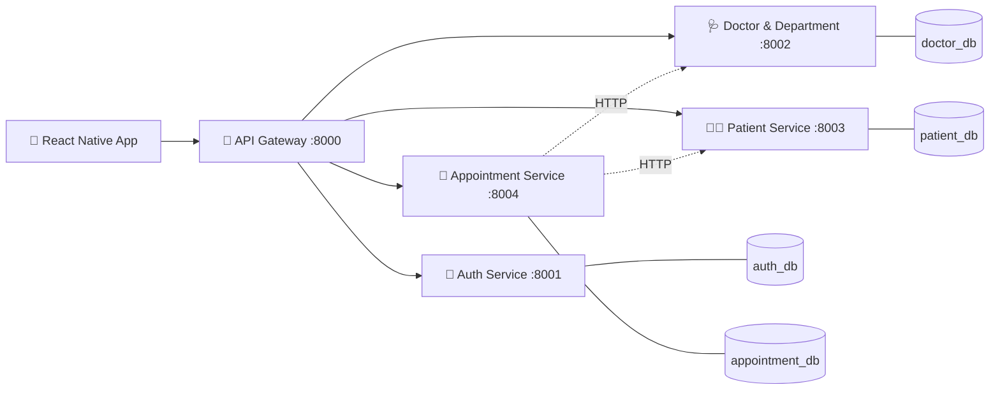
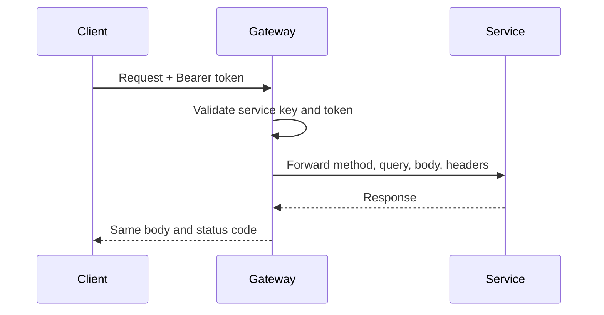

<div align="center">

# 🏥 HMS API Gateway

**The single entry point for the Hospital Management System microservices**


-F59E0B?style=for-the-badge)

[Overview](#-overview) •
[Architecture](#-architecture) •
[Routes](#-services--routes) •
[Getting Started](#-getting-started) •
[Security](#-security) •
[Roadmap](#-roadmap)

</div>

---

## 📖 Overview

HMS is built as a set of independent microservices, each with its own database. The **API Gateway** gives clients (the React Native app, Postman, etc.) **one URL** and handles cross-cutting concerns in one place instead of repeating them in every service.

> The gateway has **no database**. It receives, checks, forwards, and returns.

### ✨ Responsibilities

| | Feature | Description |
|---|---|---|
| 🔀 | **Routing** | Forwards `/api/{service}/{path}` to the matching service |
| 🔐 | **Authentication** | Rejects requests without a valid JWT on protected routes |
| 🚦 | **Rate limiting** | Throttles requests, stricter on login |
| 🌐 | **CORS** | Configured once, here only |
| 🛟 | **Error handling** | `503` if a service is down, `504` on timeout |
| 🔎 | **Request tracing** | `X-Request-Id` header to follow a request across services |
| ❤️ | **Health check** | `GET /api/health` reports gateway and service status |

---

## 🏗 Architecture



The Appointment service verifies that a patient and a doctor exist by **calling their services over HTTP**, never by reading their databases.

---

## 🧭 Services & Routes

| Service | Prefix | Purpose | Dev port |
|---|---|---|---|
| 🚪 Gateway | `/api/...` | This project | `8000` |
| 🔑 `auth` | `/api/auth/...` | Register, login, refresh token, users | `8001` |
| 🩺 `doctor` | `/api/doctor/...` | Doctors and departments | `8002` |
| 🧑‍⚕️ `patient` | `/api/patient/...` | Patient profiles | `8003` |
| 📅 `appointment` | `/api/appointment/...` | Booking and managing appointments | `8004` |

> Ports are the proposed development ports. Change them in `.env` if yours differ.

**Example**

```http
POST /api/auth/login
```
```text
Gateway  →  http://localhost:8001/api/login
```

### 🔄 Request flow



---

## 🚀 Getting Started

### Requirements

- PHP **8.2+**
- Composer
- Backend services running (the gateway starts without them, but forwarded requests return `503`)

### Installation

```bash
cd Hospital-MS/Back-end/api-gateway
composer install
cp .env.example .env
php artisan key:generate
```

### Environment

```env
APP_NAME="HMS API Gateway"
APP_ENV=local
APP_DEBUG=true

# The gateway does not use a database
SESSION_DRIVER=file
CACHE_STORE=file

# Service URLs
AUTH_SERVICE_URL=http://localhost:8001
DOCTOR_SERVICE_URL=http://localhost:8002
PATIENT_SERVICE_URL=http://localhost:8003
APPOINTMENT_SERVICE_URL=http://localhost:8004
```

### Run

```bash
php artisan serve --port=8000
```

The gateway is now available at **http://localhost:8000/api**.

<details>
<summary><b>🛠 Local development setup</b></summary>

<br>

Docker is not used at this stage.

- Each service runs on its own port with `php artisan serve`
- One local MySQL instance with a separate database per service:
  `auth_db`, `doctor_db`, `patient_db`, `appointment_db`
- Services talk to each other over plain HTTP

</details>

---

## 🔒 Security

- ✅ All validation and permission checks happen **on the server**, never on the client
- ✅ Roles: `PATIENT`, `DOCTOR`, `ADMIN`
- ✅ A patient can never read another patient's data by changing an ID (enforced by the owning service, not only the gateway)
- ✅ Admins do **not** automatically get access to medical records
- ✅ Passwords, tokens, and medical details are never written to logs
- ✅ Login is rate limited to slow down password guessing
- 🌐 Public routes (no token): registration and login only

---

## 🧪 Testing

```bash
php artisan test
```

Service calls are mocked with `Http::fake()`, so the gateway is tested without running the real services.

**End-to-end journey (Postman):** register → login → book appointment

---

## 🗺 Roadmap

### Release 1 — MVP (current)

- [x] Gateway project and service routing
- [ ] Token validation middleware
- [ ] Unified response and error format
- [ ] Rate limiting on login
- [ ] Health check endpoint
- [ ] Automated tests
- [ ] Full-journey test in Postman

### Next releases

| Release | Scope |
|---|---|
| 2 | Medical / Clinical + Prescription |
| 3 | Laboratory + Notification |
| 4 | Reports + Payments / Insurance |

<details>
<summary><b>❓ Open decisions</b></summary>

<br>

- Where the JWT is validated: gateway only, or gateway plus each service
- The unified success and error response format
- Who defines a doctor's available time slots: the doctor or the admin

</details>

---

## ⚠️ Notes

This is a learning project built to become production-ready. Free hosting is for demos only. Real patient data requires a small paid server and a review of Egypt's personal data protection law before launch.

---

<div align="center">

**Built by Mahmoud Mohamed — Dolphicode** 🐬
Qena, Egypt

</div>